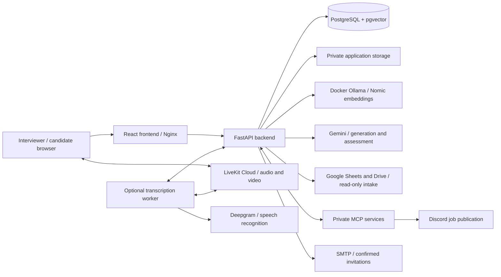

# HireSense

**AI-assisted recruitment, from job description to evidence-backed candidate assessment.**

HireSense brings job preparation, application intake, CV screening, interview scheduling,
live interviews and final assessment into one interviewer workspace. A conversational
assistant coordinates supported actions, while saved evidence, explicit approvals and
versioned results keep the interviewer in control.

Candidates apply through Google Forms and attend interviews using private invitation
links. They do not need a HireSense account. The platform supports technical and
nontechnical roles, including short live practical exercises for engineering, HR and sales.

The interviewer dashboard summarizes job activity, pending screening and upcoming
interviews. Per-job application notifications highlight responses waiting to be synced.

HireSense assists recruitment decisions; it does not autonomously hire or reject people,
guarantee model accuracy, or treat a missing assessment as a zero score.

## Contents

- [Capabilities and recruitment workflow](#capabilities-and-recruitment-workflow)
- [Architecture and technology](#architecture-and-technology)
- [AI orchestration and LangGraph workflows](#ai-orchestration-and-langgraph-workflows)
- [Scoring and evidence](#scoring-and-evidence)
- [Quick start](#quick-start)
- [Integration setup](#integration-setup)
- [Project structure](#project-structure)
- [Testing and verification](#testing-and-verification)
- [Operations and data persistence](#operations-and-data-persistence)
- [Security, privacy and limitations](#security-privacy-and-limitations)
- [Documentation](#documentation)
- [License](#license)

## Capabilities and recruitment workflow

### 1. Prepare and publish a job

Upload previous job descriptions as private reference PDFs, then describe the role to
the central assistant. Retrieval-augmented generation (RAG) uses relevant sources to
draft a job description. When more information is needed, the assistant asks follow-up
questions. Screening requirements are derived internally; there is no separate
requirement-discovery approval workflow.

Review, edit and approve the draft, or create a job description manually. Approved
versions remain preserved when a new draft is created. Prepare a Discord post and
review its destination, application link and deadline before explicitly approving
publication through the job-posting MCP service.

### 2. Collect applications

Import responses from the Google Sheet linked to the application form. HireSense
downloads PDF/DOCX CVs from Google Drive and routes each response to its job posting.
Candidate search, posting filters, pagination, private document access and application
deletion are available in the Candidates workspace.

Application profiles are isolated: a repeated email address does not allow one person's
submission to overwrite another's information. Re-sync is idempotent, and conservative
repeat detection preserves original submissions and assessment history.

### 3. Screen CVs and rank candidates

Approve the technical-skills, experience and qualifications weights, then select
**Rank candidates**. Native PDF/DOCX extraction and automatic, confidence-gated OCR for
scanned PDF pages preserve page/block references for evidence.

Private CV passages are retrieved semantically, matched against job requirements and
checked against their sources. Validated results are reused when their inputs remain
compatible. Unreadable documents and provider failures are shown as processing issues,
not fabricated zero scores. Successful applications can still be ranked in a mixed batch.

### 4. Schedule interviews

Select named candidates, checked applications, top-ranked candidates or a score
threshold. The scheduling workspace distinguishes unscheduled, scheduled and completed
interviews. Preview recipients, times, email content and calendar attachments before
confirming SMTP delivery. Rescheduling preserves history and issues confirmed updates.

The assistant and manual controls use the same scheduling services. Invitations contain
private HireSense links and `.ics` attachments; there is no external calendar-booking
integration. Delivery states distinguish sent, failed, pending and uncertain outcomes.

### 5. Conduct the interview

Candidates check devices, review the compact permissions notice and wait for admission.
The interviewer console opens on candidate information, including the application photo,
saved CV score and CV-backed topics to explore. LiveKit Cloud provides one-to-one
audio/video, with a large participant view, switchable self-preview and compact controls.

The private interview assistant can suggest job-relevant questions, analyze saved
answers and prepare practical tasks. Candidates do not see the transcript, analysis,
interviewer assistant or photo-match results.

### 6. Analyze answers and candidate performance

With both participants' consent and the interviewer starting transcription, a separate
worker sends microphone audio to Deepgram and saves final transcript text. The app
does not record interview audio or video.

**Analyze answers** identifies substantive exchanges, scores supported answers and saves
their results. Greetings, device checks and unrelated small talk are excluded; job-related
HR, sales and behavioral questions remain eligible. Concise performance summaries group
strengths, areas to improve, evidence gaps and points needing verification, with traceable
sources. Transcription gaps and uncertain wording remain visible.

### 7. Run a live practical exercise

The **Live Work-Sample Studio** adds an observable work product to CV and verbal evidence:

1. Ask the interview assistant for short tasks based on the current posting and select
   **Use this task**, or prepare a draft manually/from a saved private template.
2. Review and **Approve & share task**. The candidate reads it and confirms readiness;
   the interviewer starts the server-controlled working period, capped at 15 minutes.
3. The candidate works in a text/code workspace with autosave. The interviewer sees
   server-saved work and can ask for explanations verbally.
4. The candidate submits once. Submission locks the response; there are no additional
   candidate attempts. Expiry freezes the latest saved work with an explicit status.
5. The LLM proposes a correctness score from 0–100, supported by response quotations.
   A separate model check verifies its support. The interviewer reviews and approves
   the saved score; they do not enter or edit marks.

Tasks can be a focused code correction, HR scenario, sales response or another short,
job-relevant exercise. The workspace does not execute code, run tests, detect AI use or
prove that outside assistance was absent. Pending or unverified reviews remain unscored.

### 8. Compare final assessments

**Calculate final ranking** combines saved CV, interview and approved practical scores.
It does not call the LLM to regrade interviews. Missing or stale interview scores direct
the interviewer back to **Analyze answers**. Private HTML/PDF reports retain component
scores, evidence, limitations and their saved scoring policy.

### Optional candidate photo verification

With the candidate's in-app consent, the interviewer can request a face capture and
compare it with the expected application's uploaded photo using local YuNet/SFace
models. Results are interviewer-only; manual verification remains available.

This is optional one-to-one photo comparison, not legal-identity verification, liveness
detection or continuous monitoring. It never changes assessment scores or blocks an
interview. Leaving the permissions checkbox unchecked does not prevent joining.

## Architecture and technology

The browser uses the frontend's `/api` proxy to reach FastAPI. Business services enforce
authorization, persist workflow state and coordinate model/provider calls.



This is a component overview, not a LangGraph topology. Interview-scheduling MCP tools
forward authorized requests to the backend; job-posting MCP owns the Discord integration.
Website tunneling and media transport are separate.

| Layer | Implementation |
| --- | --- |
| Frontend | React 19, TypeScript, Vite, Tailwind CSS, LiveKit components |
| Backend | Python 3.12, FastAPI, Pydantic, SQLAlchemy, Alembic |
| Orchestration | LangGraph, LangChain Gemini tool calling, MCP over Streamable HTTP |
| Generation and assessment | Configured Gemini model; validated structured responses |
| Embeddings | `nomic-embed-text:latest` through private Docker Ollama; 768 dimensions |
| Database and retrieval | PostgreSQL 16 with pgvector; shared knowledge and private CV indexes |
| Document processing | PDF/DOCX extraction, Poppler, Tesseract OCR, HTML/PDF reporting |
| Interviews and integrations | LiveKit Cloud, optional Deepgram worker, Google Sheets/Drive, Discord, SMTP |
| Deployment and verification | Docker Compose, Nginx, pytest, Vitest, React Testing Library, Node test runner |

## AI orchestration and LangGraph workflows

HireSense uses a tool-calling supervisor and specialized workflow graphs, not a group
of independent agents making autonomous hiring decisions. The central assistant and
interview assistant reuse the supervisor definition with different tool scopes.

The central scope exposes job-description generation, editing and approval, job posting,
response sync, CV screening, interview scheduling, candidate assessments and help.
The interview scope exposes question suggestions, answer analysis, practical-task
suggestions and help. One business tool can execute per supervisor chat request;
consequential actions retain their service-level review and confirmation checks.

There are seven distinct graph definitions:

| Graph | Responsibility |
| --- | --- |
| `HireSenseSupervisorGraph` | Select a scoped tool, execute it and return its result |
| `JobPostingAssistantGraph` | Interpret publication requests and validate details |
| `ScreeningWorkflow` | Extract CV content, match requirements and validate evidence |
| `CandidateScoringWorkflow` | Calculate deterministic CV category scores and rankings |
| `InterviewAnalysisGraph` | Analyze transcript answers and their supporting evidence |
| `ConsolidatedAssessmentGraph` | Assemble assessment components and reports |
| `WorkSampleGraph` | Generate a focused practical-task draft |

The standalone requirement-discovery graph is retired. RAG-backed job drafting and
structured screening profiles remain implemented. Editable diagrams of actual nodes
and edges are in [the graph inventory](docs/langgraphs/README.md), with
[one combined draw.io file](docs/langgraphs/hiresense-all-langgraphs.drawio).

## Scoring and evidence

### CV assessment

CV scoring is deterministic after evidence validation: **Met = 1**, **Partially met = 0.5**,
and **Unmet = 0**. Approved requirement weights produce category coverage; the three
category percentages produce the CV score. Default category weights are technical
skills **50%**, experience **30%** and qualifications **20%**, adjustable to total 100%.
A category without weighted requirements must receive 0%, with its weight redistributed.

Embedding similarity retrieves passages; it is not a candidate score. Missing, corrupt,
unreadable or failed CV processing does not receive a numerical score or rank. Accepted
OCR evidence retains original page references and a warning to verify important details.

### Interview assessment

The LLM assigns supported 0–100 marks for **relevance, accuracy, completeness and quality**,
each weighted 25%. Application code averages these marks and then the included question
scores. Met/partial/unmet badges describe findings; they do not restrict numeric marks
to 0/50/100. Different-quality answers can receive different scores despite similar badges.

Verified off-topic answers and genuinely unanswered questions receive zero. Procedural
conversation is excluded. Provider failures, ambiguous transcription and missing scoring
references are not proof of an incorrect answer and remain explicit incomplete states.
Answer guides/technical references support correctness checks; unchanged validated marks
are reused rather than regenerated on every page load.

### Final ranking

```text
Final score = Interview score × 0.60 + CV score × 0.30 + Practical score × 0.10
```

For example, interview 80, CV 70 and an approved practical score of 90 produce **78.00%**.
Missing, stale, failed or unapproved required components keep a candidate unranked;
they are not silently converted to zero. Exact totals determine ties, with shared ranks
such as 1, 1, 3. Historical reports retain their saved weights and policy versions.

Saved provenance includes source references, input/model/prompt identities and scoring
snapshots. Reuse improves consistency, but neither caching nor an independent model
check guarantees correctness. Comparable rankings require consistent job requirements
and assessment policies. See [CV scoring](docs/deterministic-candidate-scoring.md),
[interview analysis](docs/interview-analysis.md) and [final assessments](docs/consolidated-assessments.md).

## Quick start

### Prerequisites

- Docker with Compose v2 and Linux containers; Docker Desktop is suitable on Windows.
- Internet for initial image/model downloads and any configured cloud integrations.
- Sufficient RAM and disk for the application, PostgreSQL and local embedding inference.
  Images can be several GB; the Nomic model download is approximately 274 MB.
- A Gemini API key for AI features. Other credentials depend on the integrations used.

Host Python, Node.js, Ollama and GPU configuration are not required for the Docker
deployment. Python 3.12 and Node.js 22 are used by the repository's container builds
and are suitable for local development/test environments.

### 1. Configure the root environment

From the repository root, create `.env` only if it does not already exist:

```powershell
if (-not (Test-Path .env)) { Copy-Item .env.example .env }
```

Set your own `POSTGRES_PASSWORD`, `JWT_SECRET_KEY`, `INTERVIEWER_EMAIL`,
`INTERVIEWER_PASSWORD`, `INTERVIEW_LINK_SECRET` and `GEMINI_API_KEY`. Use independent,
strong JWT and interview-link secrets of at least 32 characters. Select a
`GEMINI_CHAT_MODEL` available to your account; provider quota and billing remain external.

Keep `FRONTEND_URL` and `INTERVIEW_JOIN_BASE_URL` at `http://localhost:5173` for local use.
The template sets `CANDIDATE_COOKIE_SECURE=false` for local HTTP; use secure cookies and
the correct HTTPS origin for remote access. The demo helper manages those overrides.

The single repository-root `.env` is the active environment file. Do not create
`backend/.env` or `frontend/.env`, commit credentials, or put secrets in `VITE_*` variables.
Compose injects each service's settings; the frontend receives no provider API keys.

### 2. Build and start

```powershell
docker compose up -d --build
docker compose ps -a
```

Compose starts PostgreSQL, private Ollama, a lightweight model initializer, the backend,
both MCP services and the frontend. The initializer downloads Nomic only when missing,
verifies its pinned digest and a finite 768-dimensional embedding, then exits with **0**.
The backend waits for successful initialization, applies Alembic migrations and seeds
the configured interviewer account. First startup can take several minutes or longer
on slower connections.

| Local endpoint | Purpose |
| --- | --- |
| [localhost:5173](http://localhost:5173) | Interviewer sign-in and application |
| [localhost:8000/docs](http://localhost:8000/docs) | FastAPI interactive API documentation |
| [localhost:8000/api/health](http://localhost:8000/api/health) | API/database health check |

The Docker backend always uses `http://ollama:11434`. No host Ollama installation or
manual model pull is needed, and its API is not published to the host. Existing
`OLLAMA_DOCKER_BASE_URL` entries are ignored. `OLLAMA_BASE_URL` remains relevant to a
non-Docker backend only. See [Ollama setup and recovery](docs/ollama-container.md).

### 3. Sign in and prepare reference data

Sign in using the interviewer email/password configured before first startup.
There is no public signup. Changing `INTERVIEWER_PASSWORD` afterward does not reset
an existing account's password. Candidates join using their private invitation links.

Upload selectable-text historical JD PDFs under **Jobs → Reference documents**.
Automatic OCR applies to candidate CVs, not these knowledge PDFs. For synthetic
reference documents and interview questions with answer guides, explicitly run:

```powershell
docker compose exec -T backend python -m app.seed_knowledge
docker compose exec -T backend python -m app.seed_interview_questions
```

These commands write demonstration knowledge to the database and generate local
embeddings. A separate, opt-in [recruitment example loader](docs/recruitment-examples.md)
can populate complete fictional workflows. Example scores and authored judgments are
not evidence of real-model accuracy. None of these examples are loaded automatically.

## Integration setup

Configure only the services you intend to use. Containerized embeddings do not provision
Google, Gemini, Discord, SMTP, LiveKit or Deepgram accounts.

| Integration | Main settings | Setup |
| --- | --- | --- |
| Gemini | `GEMINI_API_KEY`, `GEMINI_CHAT_MODEL`, `GEMINI_TIMEOUT_SECONDS` | AI generation, screening and assessment; credentials stay backend-only |
| Ollama | `OLLAMA_EMBEDDING_MODEL`, `OLLAMA_MODEL_DIGEST` | Automatic in Docker; keep the pinned Nomic identity unless planning re-embedding |
| Google Forms intake | `GOOGLE_FORMS_SPREADSHEET_ID`, `GOOGLE_FORMS_SHEET_NAME`, `GOOGLE_FORMS_*_COLUMN` | Read-only Sheets/Drive access; see below |
| Discord | `DISCORD_BOT_TOKEN`, `DISCORD_CHANNEL_ID`, `JOB_POST_DEFAULT_*` | Fixed destination, reviewed publication; token is supplied only to job-posting MCP |
| Invitations | `SMTP_*`, `INTERVIEW_REPLY_TO_EMAIL` | Configure a real SMTP service or opt-in local Mailpit |
| Audio/video | `LIVEKIT_CLOUD_URL`, `LIVEKIT_CLOUD_API_KEY`, `LIVEKIT_CLOUD_API_SECRET` | [LiveKit Cloud setup](docs/livekit-cloud.md); no bundled local media server |
| Transcription | `TRANSCRIPTION_ENABLED`, `TRANSCRIPTION_WORKER_SECRET`, `DEEPGRAM_API_KEY` | Optional worker and explicit participant consent |
| Photo verification | `IDENTITY_ENABLED`, `IDENTITY_*` | Optional local models, private storage and candidate consent |

### Google Forms and Drive

1. Place the service-account key at `backend/secrets/google-service-account.json`.
   Share the linked response spreadsheet and uploaded-file folders with its
   `client_email` as a viewer. API enablement alone does not grant file access.
2. Set `GOOGLE_FORMS_SPREADSHEET_ID` and, if necessary, the response tab/header settings.
3. Include a required **Job Posting** form question. Prefer a value such as `Post #12`;
   an exact title is accepted only when it resolves unambiguously.
4. Accept PDF/DOCX CV uploads. For optional photo verification, add **Candidate photo**
   with one JPG/PNG upload and grant the service account access. Consent is collected
   inside HireSense, not through the Google Form.
5. Open **Candidates → Sync responses**, or ask the assistant to sync.

The integration does not alter form responses or delete original Drive uploads.
See [application-profile integrity](docs/application-profile-integrity.md) and
[candidate photo verification](docs/candidate-identification.md).

### Optional services

The following commands change local services; finish active interviews and pending
deliveries/jobs before applying configuration changes. While a public demo is active,
follow its origin-preserving procedure instead of plain base Compose commands.

- **Test email:** the template points SMTP at `mailpit`, which is not started by default.
  Start it with `docker compose --profile mail-test up -d mailpit` and inspect messages
  at [localhost:8025](http://localhost:8025). This does not deliver mail to real inboxes.
- **Transcription:** configure Deepgram, a separate worker secret and
  `TRANSCRIPTION_ENABLED=true`, then start with
  `docker compose --profile transcription up -d --build`. Both participants must consent,
  and the interviewer must start transcription. See [the transcription guide](docs/live-transcription.md).
- **Face models:** explicitly provision checksum-verified YuNet/SFace weights with
  `docker compose exec -T backend python -m app.identity.provision`. Runtime matching
  never downloads them automatically. See [identity setup and safeguards](docs/candidate-identification.md).
- **Remote website demo:** with the local app running, use
  `./scripts/start-cloudflare-demo.ps1`. It configures a temporary HTTPS origin; LiveKit
  Cloud carries audio/video separately. Use synthetic data and follow [the demo guide](docs/cloudflare-demo.md).

MCP endpoints and timeouts are centralized in [`mcp.json`](mcp.json), with separate
local and Docker addresses. Review [MCP configuration](docs/mcp-configuration.md) rather
than hardcoding endpoints or placing integration tokens in the frontend.

## Project structure

```text
hiresense/
├── backend/
│   ├── app/
│   │   ├── agents/          # Supervisor and specialized AI graphs
│   │   ├── assessments/     # Consolidation, final scoring and report templates
│   │   ├── identity/        # Local photo comparison and model provisioning
│   │   ├── integrations/    # External-service adapters
│   │   ├── interview_mcp/   # Authorized scheduling MCP tools
│   │   ├── job_posting_mcp/ # Fixed-destination Discord MCP service
│   │   ├── models/          # SQLAlchemy persistence models
│   │   ├── rag/             # Knowledge embeddings and retrieval
│   │   ├── routes/          # FastAPI endpoints
│   │   ├── schemas/         # Validated request/response schemas
│   │   ├── scoring/         # CV scoring workflow
│   │   ├── screening/       # CV parsing, OCR and semantic evidence
│   │   └── services/        # Shared business rules and workflow coordination
│   ├── alembic/             # Database migrations
│   ├── scripts/             # Verification, benchmarks and explicit example loaders
│   ├── tests/               # Backend regression and opt-in integration tests
│   ├── secrets/             # Private local credentials; ignored by Git
│   └── storage/             # Private runtime files; ignored by Git
├── frontend/                # React application, components and frontend tests
├── postgres/                # PostgreSQL image with pgvector
├── scripts/                 # PowerShell demo lifecycle and safety checks
├── docs/                    # Feature guides and editable graph diagrams
├── docker-compose.yml       # Local application and optional profiles
├── docker-compose.cloudflare.yml
├── mcp.json                 # Shared MCP endpoint registry
└── .env.example             # Configuration template, not an active secret file
```

## Testing and verification

Default automated tests use synthetic data, isolated databases and mocked providers.
They are not a claim of real-candidate scoring accuracy or a completed two-device
audio/video test. Live benchmarks and provider probes require explicit opt-in and may
consume quota; read their instructions before running them.

### Backend

Against the source packaged in the running backend image:

```powershell
docker compose exec -T backend python -m pytest -q
```

For local source tests, install `backend/requirements.txt` in a Python 3.12 virtual
environment. From `backend`, run:

```powershell
.\.venv\Scripts\python.exe -m pytest -q
.\.venv\Scripts\python.exe scripts/check_langgraph_diagrams.py
```

The graph checker validates all seven individual diagrams and both bundles against
compiled graphs without invoking workflows, providers or database operations.
Source-only diagram/Compose tests can be skipped inside runtime images where those
repository files are not packaged. Rebuild images after source changes before assuming
container tests cover the working tree.

Real PostgreSQL/pgvector integration tests require `PGVECTOR_TEST_SERVER_URL` pointing
to a disposable server with pgvector and permission to create databases. They create
and remove randomly named test databases. Do not use production credentials for tests.

### Frontend

From `frontend`, with Node.js 22 and npm installed:

```powershell
npm ci
npm run test:scoring
npm run test:interviews
npm run test:rooms
npm run build
```

These cover score presentation, scheduling helpers, React interview/workflow behavior,
TypeScript checks and the production build. The repository does not define a generic
`npm test` script; use the named commands above.

For the offline PowerShell demo-helper checks, run from the repository root:

```powershell
./scripts/test-cloudflare-demo.ps1
```

## Operations and data persistence

### Storage boundaries

| Data | Location | Persistence |
| --- | --- | --- |
| Application records, scores and vectors | PostgreSQL `postgres_data` named volume | Retained across container replacement and normal `compose down` |
| Nomic model cache | Ollama `ollama_data` named volume | Reused across restarts; no registry pull when a compatible model is cached |
| CVs, knowledge PDFs, reports and identity files | Host bind mount `backend/storage/` | Private runtime files; not bundled in images or committed |
| Google service-account key | Host bind mount `backend/secrets/` | Read-only inside the backend; ignored by Git |

Back up the database and private storage together, including the identity encryption
key when that feature is used. A database-only backup does not restore document files
or decrypt templates without their key. Changing the embedding model requires a safe
re-embedding plan for both shared knowledge and private CV passages, even if dimensions
remain 768. Do not disable digest checks to mix incompatible vectors.

### Service checks and shutdown

```powershell
docker compose ps -a
docker compose logs --tail 30 ollama-init
docker compose exec -T ollama ollama list
```

An initializer that exited with code 0 is normal. A failed digest/download/inference
check blocks normal backend startup; investigate and retry rather than bypassing it.

Finish active interviews and resolve pending deliveries/background processing before
rebuilding or restarting services. Backend source is copied into images, not live-mounted.
Do not repeatedly resend an invitation or republish a post marked **uncertain**; verify
the external outcome before an explicit retry.

For a remote demo, stop the tunnel and restore the local origin first:

```powershell
./scripts/stop-cloudflare-demo.ps1
```

Then, when safe, stop the application:

```powershell
docker compose down
```

Normal shutdown retains database/model volumes and host-mounted files. **Do not use
`docker compose down -v` unless you deliberately intend to delete named-volume data,
including the database and model cache.**

When the demo is active, plain base Compose recreation can restore localhost URLs.
Use the [Cloudflare lifecycle guide](docs/cloudflare-demo.md) for rebuilds and origin
changes. Tunnel hostnames may change; existing invitation links are not automatically
rewritten or emailed again. Finish calls before replacing links or origins.

## Security, privacy and limitations

- Interviewer actions require JWT authentication, role checks and record ownership.
  Candidate links exchange for expiring, scoped HttpOnly cookies and still require
  admission. Public registration and candidate password accounts are not supported.
- Interviewer JWTs use browser session storage. Signing out clears the browser session
  but does not revoke an already issued JWT. Production use requires a reviewed
  authentication, password-recovery, HTTPS, deployment-wide rate-limiting and
  token-revocation design.
- Private CVs, photos, transcripts and reports are not public static assets. Do not
  commit `.env`, service-account keys, invitation tokens, runtime files or exported
  candidate data. Internal Ollama/MCP/worker ports are not published by default.
- Embeddings, OCR and photo matching run locally. Gemini receives relevant text for
  generation/assessment; LiveKit carries interview media, and consented transcription
  sends microphone audio to Deepgram. The system is not wholly offline.
- Use only data approved for the configured providers and processing arrangements.
  Use synthetic, non-sensitive information for public demos and unpaid/demo APIs.
- Final transcript text and practical work have configurable retention (30 days by
  default). Identity data has separate retention and withdrawal controls. Expiry or
  deletion of source evidence can invalidate derived reports; retain required evidence
  through authorized policies, not by disabling cleanup casually.
- Photo comparison does not establish official identity or provide anti-spoofing/liveness
  guarantees. Unclear matches require human review and never affect marks.
- Speech recognition and LLM assessment can be wrong. Validated evidence, bounded
  retries and cached results improve auditability but do not guarantee perfect grading,
  fairness, candidate capability or future job performance.
- Practical submissions are text/code artifacts, not executed programs. There is no
  plagiarism/AI-use detector, automatic hiring decision, external calendar synchronization
  or interview audio/video recording.
- Quota exhaustion, connectivity errors, missing guides and unreadable sources remain
  visible failures/incomplete states. Do not turn infrastructure errors into zero marks.

## Documentation

The README is the project entry point; detailed implementation and setup references
are maintained alongside it:

| Area | Guides |
| --- | --- |
| Access and workspaces | [Account access](docs/account-access.md), [dashboard](docs/interviewer-dashboard.md), [Jobs](docs/jobs-workspace.md), [workflow navigation](docs/workflow-navigation.md) |
| Architecture and integrations | [LangGraphs and diagrams](docs/langgraphs/README.md), [MCP configuration](docs/mcp-configuration.md), [Ollama](docs/ollama-container.md) |
| Applications and CVs | [Profile integrity](docs/application-profile-integrity.md), [application notifications](docs/application-notifications.md), [semantic screening](docs/robust-cv-screening.md), [OCR](docs/cv-ocr.md), [CV scoring](docs/deterministic-candidate-scoring.md) |
| Interviews | [Scheduling](docs/interview-scheduling.md), [room access](docs/interview-rooms.md), [LiveKit Cloud](docs/livekit-cloud.md), [interview copilot](docs/interview-copilot.md), [transcription](docs/live-transcription.md) |
| Assessment | [Answer analysis](docs/interview-analysis.md), [live practical exercises](docs/live-work-samples.md), [final rankings and reports](docs/consolidated-assessments.md) |
| Photo verification and demos | [Identification safeguards](docs/candidate-identification.md), [recruitment examples](docs/recruitment-examples.md), [Cloudflare demo](docs/cloudflare-demo.md) |

Some feature guides retain migration histories and dated validation snapshots. For
current behavior, use this overview together with the relevant guide and source code;
historical benchmark results are not guarantees for a new model or deployment.

## License

This repository currently has no project-wide license file. Third-party dependencies
and model weights retain their respective licenses; the identity-model provisioner
stores the associated upstream license notices with the downloaded weights.
