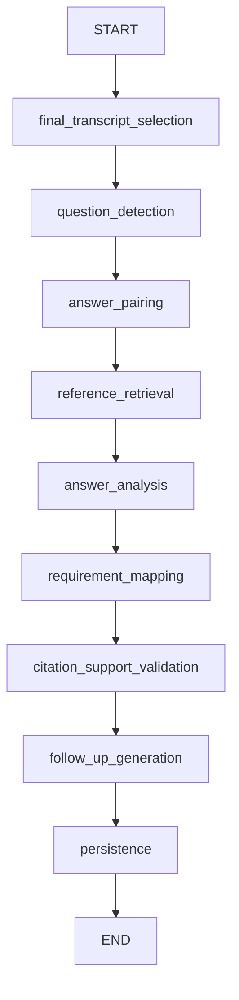

# Feature 5 — Interview answers and requirement evidence

This feature analyzes persisted final transcripts for the assigned interviewer. It
does not change CV scores, candidate rankings, hiring decisions, LiveKit tracks, or
candidate captions. Interim text never enters the analysis workflow.

## Using the feature

1. Open the interview console. Obtain both participants' transcription consent and
   start transcription as usual. Existing saved transcripts can also be analyzed.
2. In **Interview answers & evidence**, optionally open **Approved answer guides &
   technical references**, paste relevant material, and explicitly approve it.
   References belong to this interview. A question bank, JD, or CV is not automatically
   treated as an approved correctness reference.
3. Click **Analyze saved answers**. The HTTP request saves a queued run and returns
   immediately. **Continue as new answers arrive** enables updates at most once per
   20-second inspection interval when inputs change. Stop automatic updates from the
   panel when desired. No model request is made merely by opening or refreshing it.
4. Review the question–answer timeline. An interviewer question may contain several
   segments/subparts. Candidate clarification and interviewer acknowledgements remain
   context. A new substantive question closes the prior exchange. A pause or final
   STT event does not. Use **The answer is finished — analyze it** for an explicit
   boundary, or correct the pairing. Overlap, uncertain turns, low confidence and
   session gaps remain visible. Unanswered/procedural exchanges are not graded.
5. Inspect relevance, accuracy, completeness and quality separately. These are
   descriptive labels, not numeric scores. Generated expected elements are provisional.
   Accuracy without an applicable approved reference is **unable to verify**.
6. Click a transcript quote to open the exact saved source version with the quoted
   characters highlighted. Technical reference quotes are shown separately. There
   is no audio playback because this application does not record audio.
7. Review requirement coverage. **Not assessed** is not **unmet**. Multiple supporting
   and contradictory mappings remain visible together. Choose follow-ups yourself.
   **Mark used** is a workflow annotation; **Link spoken question** explicitly confirms
   a corresponding interviewer transcript passage.
8. Use **Correct pairing / merge / split** to move segments between question, answer,
   and context, merge exchanges, add a split, mark unanswered, or exclude procedural
   conversation. All original associated segments must remain accounted for. Saving
   a reason queues a new version and preserves the earlier results. Assessment review
   notes are append-only annotations; they do not overwrite generated conclusions.
9. Choose a previous version to inspect its source snapshots and reviews. The central
   chatbot can retrieve saved evidence, assessments, unassessed requirements and next
   questions. If inputs are missing/stale it queues analysis and reports that status;
   it does not pretend an unfinished analysis has completed.

## Actual graph and background execution

`app/agents/interview_analysis.py` builds a typed `StateGraph` with these real nodes:



The central supervisor's native `ToolNode` now exposes `interview_analysis` alongside
`suggest_interview_questions` and `help` in its interview-room capability scope.
Recruitment mutation tools remain unavailable in that scope. The analysis subgraph
uses structured generation, not an autonomous tool loop.

The service reuses `SessionLocal`, the Gemini structured client, and the backend's
existing lifespan/background-thread pattern. A durable database queue is serviced
by one background coroutine, with model work in `asyncio.to_thread`. The LiveKit /
Deepgram worker is unchanged and receives no analysis code or outputs. Restart
recovery resets interrupted processing jobs to queued. This implementation targets
the existing single backend process; it is not a distributed lease queue for multiple
API replicas. Atomic queued-to-processing claims prevent duplicate execution within
normal operation; multi-replica restart recovery needs a shared lease design.

Each provider call has a 45-second timeout and at most two attempts. Each stage
checks cancellation/ownership before continuing. New versions cancel obsolete queued
or running work; already-in-flight network requests cannot be recalled, but their
results cannot overwrite a superseding run. Errors persist safe messages without
provider bodies, transcript text, or prompts in logs. Partial failures remain visible.

Final selection reads only this interview's unexpired persisted segments. The saved
watermark contains every source ID and content hash (current transcript rows have no
mutable revision mechanism). A later run classifies only new segments when earlier
inputs remain compatible; completed unchanged exchanges reuse saved assessments.
New finals, requirements, references, prompts, models or corrected associations produce
new snapshots. Explicit reanalysis creates a new version even with identical inputs.
After all transcription sessions finish flushing (`completed` or `failed`), the next
automatic check reconciles the last exchange and unanswered questions. Failed or
interrupted transcription is visibly marked incomplete. Final reconciliation requires
automatic updates to remain enabled, or a manual analysis request after transcription.

## Evidence and references

Pairing uses a validated model classification followed by conservative deterministic
association rules. It is not guaranteed to infer every conversational boundary;
interviewer corrections remain necessary for ambiguous or interrupted exchanges.
Additional speech overlapping a manually fixed exchange is listed as unpaired for
review instead of silently changing the correction.

Approved references are stored as interview-scoped versioned snapshots. Retrieval
prioritizes answer guides, ranks lexical overlap, and includes at most six documents
per exchange. This feature does not automatically trust the existing global question
bank, browse the web, or ingest CV text as a correctness reference. Future integration
with an approved global reference collection can replace this small retrieval stage.

Every retained quote must exist exactly within a permitted source segment. The backend
adds interview/session IDs, a content-hash revision, speaker, authoritative segment
times, and character offsets; model-provided timestamps/roles are never trusted.
Assessment and mapping citations are restricted to the pair's candidate-answer
segments. Technical citations must exist in the approved reference snapshot.

A separate structured model call checks whether the validated quotations logically
support the proposed assessment/mapping. Invalid or unsupported claims are downgraded
to review-required descriptive results and generic explanations; they are not presented
as established facts. This additional model check is fallible and is not external fact
verification. Model confidence is never represented as verified truth. Candidate
project claims without reference support remain unverified rather than false.

Follow-ups cite their triggering question/answer passages, name requirements and explain
their purpose and priority. History is passed to generation and a normalized similarity
filter removes obvious duplicates. Semantic paraphrase detection remains imperfect.
Used/dismissed/link annotations are persisted separately; no question is spoken or sent
to the candidate automatically.

Gemini rejected the original large schema bounds with HTTP 400 during the synthetic
provider check. The graph now removes length/count bounds and defaults from the schema
sent to Gemini while retaining all limits in local Pydantic validation. Google documents
that large/deep schemas may be rejected in its [structured-output documentation](https://ai.google.dev/gemini-api/docs/generate-content/structured-output?hl=en).
The prompt size is bounded at 200,000 characters and long transcripts are classified
in batches of 60 new segments. Oversized exchanges fail visibly for review rather than
being silently truncated into a misleading assessment.

## Persistence, access, and retention

Migration `0021_interview_analysis` adds three tables without modifying existing data:

| Table | Contents |
| --- | --- |
| `interview_analysis_controls` | Automatic-update setting and approved-reference revision. |
| `interview_analysis_runs` | Input fingerprint, version, status/stage, requesting user, complete immutable source/configuration snapshot and structured result. |
| `interview_analysis_reviews` | Append-only pairing corrections, reviewer notes and suggestion-use/link records. |

Pairs, four-dimensional assessments, many-to-many requirement mappings, follow-ups and
validation outcomes use JSONB inside the run result. The requirement snapshot prefers
the approved scoring configuration used to schedule the interview. Legacy interviews
without that configuration use the currently approved profile at analysis request time;
the snapshot records this provenance explicitly. No CV scoring table is updated.

All API routes require the assigned interviewer's JWT and active interviewer role,
checked before loading context. Candidate cookies do not grant access. Source snapshots
retain exact finalized text until their earliest input-session expiry. Expired analysis
and corresponding assistant messages are hidden on reads. The existing transcript purge
also removes derived analysis, and transcript/application deletion removes associated
runs/reviews/controls. Historical version preservation does not override explicit
deletion or retention. Database backup retention remains an operational concern.

Endpoints under `/api/interview-rooms/{id}/analysis`:

| Method/path | Purpose |
| --- | --- |
| `GET /analysis?run_id=...` | Progress, timeline, assessments/citations, coverage, suggestions, source snapshot, versions and reviews. |
| `POST /analysis` | Start/update automatic analysis, explicitly finalize the last exchange, or request reanalysis. Returns 202 and durable run identity. |
| `PUT /analysis/references` | Explicitly approve/version the reference set with optimistic revision checking. |
| `POST /analysis/pairing` | Correct the latest completed pairing and enqueue a new version. |
| `POST /analysis/{run_id}/reviews` | Save assessment notes or suggestion used/dismissed/linked annotations. |

## Configuration and deployment

No new credentials, environment files, dependency packages, ports, or media-worker
settings are required. The existing `GEMINI_API_KEY` and `GEMINI_CHAT_MODEL` are reused.
The existing backend entrypoint runs Alembic upgrade on startup. End active interviews
before recreating backend/frontend, and preserve the current Cloudflare origin through
`scripts/cloudflare-demo-common.ps1`. Do not recreate the tunnel to deploy this feature.

The database downgrade refuses to discard existing analysis runs. Export or explicitly
delete them before intentionally reverting the migration.

## Files and affected structure

`+` denotes a new file; `~` denotes an integration change.

```text
backend/
  alembic/versions/+ 0021_interview_analysis.py
  app/
    + benchmark_interview_analysis.py
    ~ main.py
    ~ purge_transcripts.py
    agents/
      + interview_analysis.py
      ~ supervisor.py
      ~ supervisor_tools.py
    models/
      + interview_analysis.py
      ~ __init__.py
    routes/+ interview_analysis.py
    schemas/
      + interview_analysis.py
      ~ interview_copilot.py
    services/
      + interview_analysis.py
      ~ interview_copilot.py
      ~ supervisor_service.py
      ~ transcription_service.py
  tests/
    + test_interview_analysis.py
    ~ test_interview_copilot.py
frontend/
  src/components/interviews/
    + analysisApi.ts
    + InterviewAnalysisPanel.tsx
    + TranscriptCitation.tsx
    ~ InterviewCopilotPanel.tsx
  src/pages/~ InterviewerConsolePage.tsx
  tests/rooms/+ analysis.test.tsx
docs/+ interview-analysis.md
docs/~ interview-copilot.md
docs/langgraphs/~ README.md
~ README.md
```

## Verification

Automated tests use synthetic English text and mocked AI responses. Coverage includes
multi-segment and multi-part exchanges, acknowledgements, clarifications, overlapping
speech, gaps, unanswered/procedural content, merge/split/correction, independent citation
and logical-support validation, approval references, unassessed requirements, conflicting
evidence, follow-up use/link semantics, duplication, incremental/final reconciliation,
version persistence, authorization, prompt-injection isolation, expiry/deletion, failed
providers, restart recovery, and cancellation. Frontend tests cover restored results,
exact passage highlighting, correction validation, approval and suggestion annotations.

Commands:

```powershell
cd backend
.venv/Scripts/python.exe -m pytest -q tests --ignore=tests/transcription_worker
# Optional real Gemini usage; synthetic text only, no DB or media:
.venv/Scripts/python.exe -m app.benchmark_interview_analysis --live
cd ../frontend
npm.cmd run test:rooms
npm.cmd run build
```

Actual provider measurement on 19 October 2026, configured `gemini-3.5-flash-lite`:

| Synthetic case | Wall time | Pairing vs labelled source IDs | Accuracy label | Separate support checks |
| --- | --- | --- | --- | --- |
| Atomicity answer with approved guide | 11.42 seconds | Correct | supported | 5/5 passed |
| Personal project claim without reference | 11.97 seconds | Correct | unable_to_verify | 5/5 passed |

Both produced assessments and follow-ups without partial errors. These two examples
do not establish general analysis accuracy, fairness, latency under load, or transcript
recognition quality. There was no real candidate transcript, audio, video or live
interview in this benchmark. Earlier schema attempts returned HTTP 400 and produced
no analysis; those failed requests are not included as successful latency measurements.

Deployment/check record, 19 October 2026:

- Final local backend suite: **295 passed, 9 skipped**.
- Full Linux backend suite: **294 passed, 9 skipped**; after the final chatbot and
  suggestion-annotation changes, **37 analysis/copilot tests passed in the final image**.
- Frontend room/UI suite: **47 passed**. TypeScript/Vite production builds passed,
  including the final Docker frontend build. Existing large-bundle and LangGraph
  deprecation warnings remain; they are unrelated to this feature.
- Critical Python/unused-import lint and Git whitespace checks passed. SQLite
  migration upgrade/downgrade preservation was tested. PostgreSQL is now at
  `0021_interview_analysis`; the three new tables are deployed and no interview
  analysis was started against real candidate data during deployment.
- Backend/frontend images built and services updated after confirming no active
  interviews or pending deliveries. All services report running; backend,
  PostgreSQL, both MCP services and transcription worker report healthy.
- Local API health: **200**. Assigned-interviewer analysis read: **200**.
  Unauthenticated analysis read: **401**.
- The configured public origin still matches the running tunnel's advertised
  hostname. Public health could not be verified: Docker reported a DNS failure,
  Windows could not reach it, and the tunnel readiness endpoint was unavailable.
  The tunnel was not recreated and its hostname was not changed by this deployment.
- No new real two-person interview or visual browser acceptance session was run.
  Use the following manual steps for the live UI/media boundary.

Manual acceptance: analyze a consented synthetic conversation, inspect each source,
refresh, change a pairing and confirm both versions remain, approve a reference and
reanalyze, mark/link/dismiss follow-ups, ask the central chatbot for evidence, and confirm
the candidate interface contains none of these private controls. Stop transcription,
wait for the final flush and confirm the last exchange reconciles. These actions can
use provider credits; automated tests do not.

Suggested commit boundaries:

1. `feat: persist versioned interview analysis and conservative QA pairing`
2. `feat: analyze interview answers with validated transcript evidence`
3. `feat: map interview evidence to requirements and suggest follow-ups`
4. `feat: expose owned interview analysis APIs and supervisor tool`
5. `feat: add interviewer answer review and pairing correction panels`
6. `test: verify interview analysis and document synthetic provider results`
