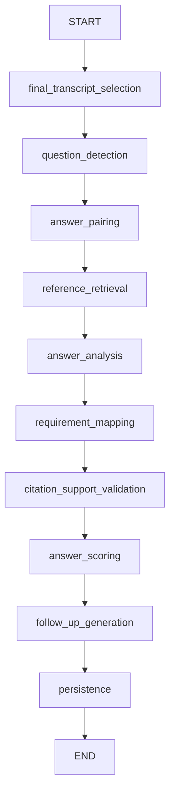

# Feature 5 — Interview answers and requirement evidence

This feature analyzes persisted final transcripts for the assigned interviewer. It
does not change CV scores, candidate rankings, hiring decisions, LiveKit tracks, or
candidate captions. Interim text never enters the analysis workflow.

## Using the feature

1. Open the interview console. Obtain both participants' transcription consent and
   start transcription as usual. Existing saved transcripts can also be analyzed.
2. The question bank stores each suggested question with its answer guide and
   expected elements. Run `python -m app.seed_interview_questions` to index or upgrade
   the 24 synthetic question/guide records. There is no per-interview guide-entry
   or approval section. Previous JDs and CVs are not correctness references.
3. Click **Analyze answers**. The HTTP request saves a queued run and returns
   immediately. **Update as answers arrive** enables updates at most once per
   20-second inspection interval when inputs change. **Scoring options** contains
   **Analyze again**, **Stop live updates** and the short scoring explanation.
   No model request is made merely by opening or refreshing the panel.
4. Read the numbered **Questions & answers** cards. Each card shows the question,
   candidate's answer and percentage, with compact, color-coded Met, Partially met
   and Unmet labels for the four scoring categories. An interviewer question may contain several
   segments/subparts. Candidate clarification and interviewer acknowledgements remain
   context. A new substantive question closes the prior exchange. A pause or final
   STT event does not. Use **Score this answer now** for an explicit boundary.
   Transcript gaps and analysis failures remain visible. Unanswered questions receive 0;
   procedural/excluded conversation and unfinished answers are not scored.
5. Each completed answer receives a percentage and a four-part breakdown. Relevance,
   accuracy, completeness and quality each weigh 25%. Met earns 1, partially met 0.5,
   and unmet 0. The percentage is `25 × (relevance + accuracy + completeness + quality)`.
   Python calculates scores after quote and logical-support validation. Unsupported
   evidence earns 0; accuracy and completeness additionally require a cited reference
   (an answer guide for completeness). A missing reference does not prove a personal
   claim false; the explanation records the missing support. No result is placed in
   a "needs review" queue. Provider failures remain retryable errors, not candidate scores.
6. Question cards show the question, candidate answer, percentage and brief category
   explanations. The per-answer **Evidence & details** expander, cited passages,
   reference quotes and full explanations are no longer rendered here. Saved evidence,
   references and original score explanations remain intact in backend records.
   Citation verification in other views is unchanged.
7. **Other transcript passages** shows remaining conversation in compact, spaced
   cards with readable text and small elapsed timestamps. Interviewer passages use
   blue and candidate passages use amber. Long text
   wraps within the panel. The **Job requirements covered** section is no longer
   displayed; its saved mappings are unchanged. Source gaps, errors and outdated
   inputs remain visible.

The panel always loads the latest analysis. Pairing/merge/split editing, manual review
notes, suggested follow-ups and their annotation/linking controls, and analysis-version
selection are no longer offered here. Their unused frontend request methods are
removed. Backend records, historical snapshots and the analysis graph are unchanged;
immutable run IDs remain necessary to verify evidence links. The central assistant's
analysis and question tools are also unchanged.

Known missing-evidence boilerplate is shortened for display without changing scores
or claiming that missing support proves an answer wrong. Original wording remains
in saved records. Met earns 1, partially met 0.5, unmet 0, with equal weights.

## Actual graph and background execution

`app/agents/interview_analysis.py` builds a typed `StateGraph` with these real nodes:



The central supervisor's native `ToolNode` now exposes `interview_analysis` alongside
`suggest_interview_questions` and `help` in its interview-room capability scope.
Recruitment mutation tools remain unavailable in that scope. The analysis subgraph
uses structured generation, not an autonomous tool loop.

The service reuses `SessionLocal`, the Gemini structured client, and the backend's
existing lifespan/background-thread pattern. A durable database queue is serviced
by one background coroutine, with model work in `asyncio.to_thread`. The LiveKit /
Deepgram worker is unchanged and receives no analysis code or outputs. Restart
recovery resets interrupted processing jobs to queued. This implementation targets
the existing single backend process; it is not a distributed lease queue for multiple
API replicas. Atomic queued-to-processing claims prevent duplicate execution within
normal operation; multi-replica restart recovery needs a shared lease design.

Each provider call has a 45-second timeout and at most two attempts. Each stage
checks cancellation/ownership before continuing. New versions cancel obsolete queued
or running work; already-in-flight network requests cannot be recalled, but their
results cannot overwrite a superseding run. Errors persist safe messages without
provider bodies, transcript text, or prompts in logs. Partial failures remain visible.

Final selection reads only this interview's unexpired persisted segments. The saved
watermark contains every source ID and content hash (current transcript rows have no
mutable revision mechanism). A later run classifies only new segments when earlier
inputs remain compatible; completed unchanged exchanges reuse saved assessments.
New finals, requirements, references, prompts, models or corrected associations produce
new snapshots. Explicit reanalysis creates a new version even with identical inputs.
After all transcription sessions finish flushing (`completed` or `failed`), the next
automatic check reconciles the last exchange and unanswered questions. Failed or
interrupted transcription is visibly marked incomplete. Final reconciliation requires
automatic updates to remain enabled, or a manual analysis request after transcription.

## Evidence and references

Pairing uses a validated model classification followed by conservative deterministic
association rules. It is not guaranteed to infer every conversational boundary;
interviewer corrections remain necessary for ambiguous or interrupted exchanges.
Additional speech overlapping a manually fixed exchange is listed as unpaired for
review instead of silently changing the correction.

Question-bank records marked with `metadata.answer_guide` are snapshotted with their
document ID, chunk IDs, question, content hash and guide content. The background worker
uses existing Ollama embeddings and pgvector question-bank search for each spoken
question; at most six matching snapshots reach assessment. Semantic matches need no
literal word overlap. GET/page refresh reads database snapshots without calling
embeddings or a model. Changed guides make earlier analyses stale. Seed upgrades retain
document IDs and replace only synthetic dataset chunks after new embeddings succeed;
the JD collection is unaffected. Legacy interview-scoped references remain readable
for existing versions/API clients; there is no entry UI. Historical results receive
the current deterministic scoring projection on read, without rewriting saved sources.

Every retained quote must exist exactly within a permitted source segment. The backend
adds interview/session IDs, a content-hash revision, speaker, authoritative segment
times, and character offsets; model-provided timestamps/roles are never trusted.
Assessment and mapping citations are restricted to the pair's candidate-answer
segments. Technical citations must exist in the approved reference snapshot.

A separate structured model call checks whether the validated quotations logically
support the proposed assessment/mapping. Invalid or unsupported claims are downgraded
to zero-credit criteria and evidence-gap explanations; they are not presented
as established facts. This additional model check is fallible and is not external fact
verification. Model confidence is never represented as verified truth. Candidate
project claims without reference support remain unverified rather than false.

Follow-ups cite their triggering question/answer passages, name requirements and explain
their purpose and priority. History is passed to generation and a normalized similarity
filter removes obvious duplicates. Semantic paraphrase detection remains imperfect.
Used/dismissed/link annotations are persisted separately; no question is spoken or sent
to the candidate automatically.

Gemini rejected the original large schema bounds with HTTP 400 during the synthetic
provider check. The graph now removes length/count bounds and defaults from the schema
sent to Gemini while retaining all limits in local Pydantic validation. Google documents
that large/deep schemas may be rejected in its [structured-output documentation](https://ai.google.dev/gemini-api/docs/generate-content/structured-output?hl=en).
The prompt size is bounded at 200,000 characters and long transcripts are classified
in batches of 60 new segments. Oversized exchanges fail visibly with a retryable error rather than
being silently truncated into a misleading assessment.

## Persistence, access, and retention

Migration `0021_interview_analysis` adds three tables without modifying existing data:

| Table | Contents |
| --- | --- |
| `interview_analysis_controls` | Automatic-update setting and approved-reference revision. |
| `interview_analysis_runs` | Input fingerprint, version, status/stage, requesting user, complete immutable source/configuration snapshot and structured result. |
| `interview_analysis_reviews` | Append-only pairing corrections, reviewer notes and suggestion-use/link records. |

Pairs, four-dimensional assessments, many-to-many requirement mappings, follow-ups and
validation outcomes use JSONB inside the run result. The requirement snapshot prefers
the approved scoring configuration used to schedule the interview. Legacy interviews
without that configuration use the currently approved profile at analysis request time;
the snapshot records this provenance explicitly. No CV scoring table is updated.

All API routes require the assigned interviewer's JWT and active interviewer role,
checked before loading context. Candidate cookies do not grant access. Source snapshots
retain exact finalized text until their earliest input-session expiry. Expired analysis
and corresponding assistant messages are hidden on reads. The existing transcript purge
also removes derived analysis, and transcript/application deletion removes associated
runs/reviews/controls. Historical version preservation does not override explicit
deletion or retention. Database backup retention remains an operational concern.

Endpoints under `/api/interview-rooms/{id}/analysis`:

| Method/path | Purpose |
| --- | --- |
| `GET /analysis?run_id=...` | Progress, timeline, assessments/citations, coverage, suggestions, source snapshot, versions and reviews. |
| `POST /analysis` | Start/update automatic analysis, explicitly finalize the last exchange, or request reanalysis. Returns 202 and durable run identity. |
| `PUT /analysis/references` | Legacy compatibility API for interview-scoped references; new guides live in the question knowledge base. |
| `POST /analysis/pairing` | Correct the latest completed pairing and enqueue a new version. |
| `POST /analysis/{run_id}/reviews` | Save assessment notes or suggestion used/dismissed/linked annotations. |

## Configuration and deployment

No new credentials, environment files, dependency packages, ports, or media-worker
settings are required. The existing `GEMINI_API_KEY` and `GEMINI_CHAT_MODEL` are reused.
The existing backend entrypoint runs Alembic upgrade on startup. End active interviews
before recreating backend/frontend, and preserve the current Cloudflare origin through
`scripts/cloudflare-demo-common.ps1`. Do not recreate the tunnel to deploy this feature.

The database downgrade refuses to discard existing analysis runs. Export or explicitly
delete them before intentionally reverting the migration.

## Files and affected structure

`+` denotes a new file; `~` denotes an integration change.

```text
backend/
  alembic/versions/+ 0021_interview_analysis.py
  app/
    + benchmark_interview_analysis.py
    ~ main.py
    ~ purge_transcripts.py
    agents/
      + interview_analysis.py
      ~ supervisor.py
      ~ supervisor_tools.py
    models/
      + interview_analysis.py
      ~ __init__.py
    routes/+ interview_analysis.py
    schemas/
      + interview_analysis.py
      ~ interview_copilot.py
    services/
      + interview_analysis.py
      ~ interview_copilot.py
      ~ supervisor_service.py
      ~ transcription_service.py
  tests/
    + test_interview_analysis.py
    ~ test_interview_copilot.py
frontend/
  src/components/interviews/
    + analysisApi.ts
    + InterviewAnalysisPanel.tsx
    + TranscriptCitation.tsx
    ~ InterviewCopilotPanel.tsx
  src/pages/~ InterviewerConsolePage.tsx
  tests/rooms/+ analysis.test.tsx
docs/+ interview-analysis.md
docs/~ interview-copilot.md
docs/langgraphs/~ README.md
~ README.md
```

## Verification

Automated tests use synthetic English text and mocked AI responses. Coverage includes
multi-segment and multi-part exchanges, acknowledgements, clarifications, overlapping
speech, gaps, unanswered/procedural content, merge/split/correction, independent citation
and logical-support validation, approval references, unassessed requirements, conflicting
evidence, follow-up use/link semantics, duplication, incremental/final reconciliation,
version persistence, authorization, prompt-injection isolation, expiry/deletion, failed
providers, restart recovery, and cancellation. Frontend tests cover restored results,
exact passage highlighting, correction validation, approval and suggestion annotations.

Commands:

```powershell
cd backend
.venv/Scripts/python.exe -m pytest -q tests --ignore=tests/transcription_worker
# Optional real Gemini usage; synthetic text only, no DB or media:
.venv/Scripts/python.exe -m app.benchmark_interview_analysis --live
cd ../frontend
npm.cmd run test:rooms
npm.cmd run build
```

Actual provider measurement on 19 October 2026, configured `gemini-3.5-flash-lite`:

| Synthetic case | Wall time | Pairing vs labelled source IDs | Accuracy label | Separate support checks |
| --- | --- | --- | --- | --- |
| Atomicity answer with approved guide | 11.42 seconds | Correct | supported | 5/5 passed |
| Personal project claim without reference | 11.97 seconds | Correct | unable_to_verify | 5/5 passed |

Both produced assessments and follow-ups without partial errors. These two examples
do not establish general analysis accuracy, fairness, latency under load, or transcript
recognition quality. There was no real candidate transcript, audio, video or live
interview in this benchmark. Earlier schema attempts returned HTTP 400 and produced
no analysis; those failed requests are not included as successful latency measurements.

Deployment/check record, 19 October 2026:

- Final local backend suite: **295 passed, 9 skipped**.
- Full Linux backend suite: **294 passed, 9 skipped**; after the final chatbot and
  suggestion-annotation changes, **37 analysis/copilot tests passed in the final image**.
- Frontend room/UI suite: **47 passed**. TypeScript/Vite production builds passed,
  including the final Docker frontend build. Existing large-bundle and LangGraph
  deprecation warnings remain; they are unrelated to this feature.
- Critical Python/unused-import lint and Git whitespace checks passed. SQLite
  migration upgrade/downgrade preservation was tested. PostgreSQL is now at
  `0021_interview_analysis`; the three new tables are deployed and no interview
  analysis was started against real candidate data during deployment.
- Backend/frontend images built and services updated after confirming no active
  interviews or pending deliveries. All services report running; backend,
  PostgreSQL, both MCP services and transcription worker report healthy.
- Local API health: **200**. Assigned-interviewer analysis read: **200**.
  Unauthenticated analysis read: **401**.
- The configured public origin still matches the running tunnel's advertised
  hostname. Public health could not be verified: Docker reported a DNS failure,
  Windows could not reach it, and the tunnel readiness endpoint was unavailable.
  The tunnel was not recreated and its hostname was not changed by this deployment.
- No new real two-person interview or visual browser acceptance session was run.
  Use the following manual steps for the live UI/media boundary.

Manual acceptance: analyze a consented synthetic conversation, inspect each source,
refresh, change a pairing and confirm both versions remain, update a knowledge-base guide
and reanalyze, check percentage breakdowns, mark/link/dismiss follow-ups, ask the chatbot for evidence, and confirm
the candidate interface contains none of these private controls. Stop transcription,
wait for the final flush and confirm the last exchange reconciles. These actions can
use provider credits; automated tests do not.

Suggested commit boundaries:

1. `feat: persist versioned interview analysis and conservative QA pairing`
2. `feat: analyze interview answers with validated transcript evidence`
3. `feat: map interview evidence to requirements and suggest follow-ups`
4. `feat: expose owned interview analysis APIs and supervisor tool`
5. `feat: add interviewer answer review and pairing correction panels`
6. `test: verify interview analysis and document synthetic provider results`

## Question-bank scoring update verification — 19 October 2026

- Full backend suite: **304 passed, 9 skipped**. Linux analysis/copilot suite:
  **46 passed**; final historical-result/supervisor checks: **3 passed**.
- Frontend room suite: **47 passed**. TypeScript/Vite and Docker backend/frontend
  builds passed. Python syntax and `git diff --check` passed.
- Upgraded the existing **24** synthetic question documents in place: **24 guides**
  and **24 embedded chunks**, with no duplicate documents. PostgreSQL semantic
  retrieval found the transaction guide for a transaction-consistency query.
- Backend/frontend were refreshed after checking no active interviews or pending
  deliveries. Public `/api/health` returned **200** using the existing tunnel origin.
- Existing automatic analysis picked up the knowledge-base update. The latest run
  completed with **8 pairs and 8 scored answers**, without a run error.
- No schema migration, new environment setting or media-worker update is required.
  Unit tests mock the model/provider; the running automatic analysis uses the
  interview's existing saved transcript and configured Gemini client.
## Question-side coverage update (Feature 6 integration)

Question detection now attaches approved requirement IDs to spoken questions.
Coverage distinguishes asked-but-unanswered, answer-pending, answered and never
explored requirements. No question-side coverage is treated as proof of capability.
Pairing version `question-coverage-turn-pairing-v2` prevents reuse of stale detection
output. Older stored analyses remain unchanged; explicitly reanalyze them to obtain
this additional coverage. See [Feature 6](consolidated-assessments.md) for report
source selection, provenance, exports, comparison and retention integration.
